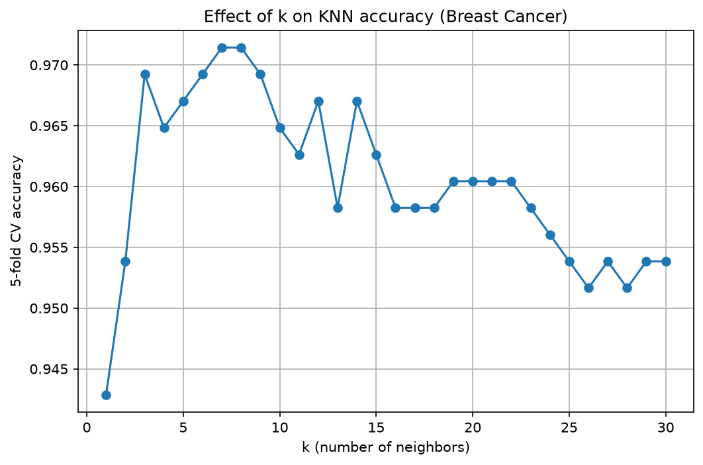
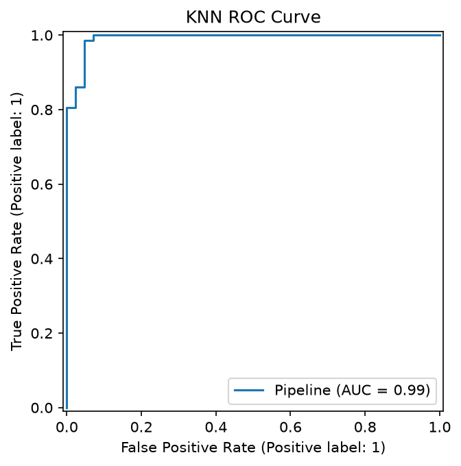

# K-Nearest Neighbors (KNN) Classifier

Binary classification (malignant vs. benign) on the Breast Cancer Wisconsin dataset.

## What I learned
- How KNN classifies using the labels of the k nearest points
- Why feature scaling is essential for distance-based models
- How k affects bias vs. variance (small k overfits, large k underfits)
- Tuning with GridSearchCV inside a Pipeline to avoid data leakage

## Run
pip install -r ../../requirements.txt
python knn.py

## Results
- Best params: (paste from terminal)
- Test accuracy: (paste from terminal)
- ROC-AUC: (paste from terminal)

## Figures

